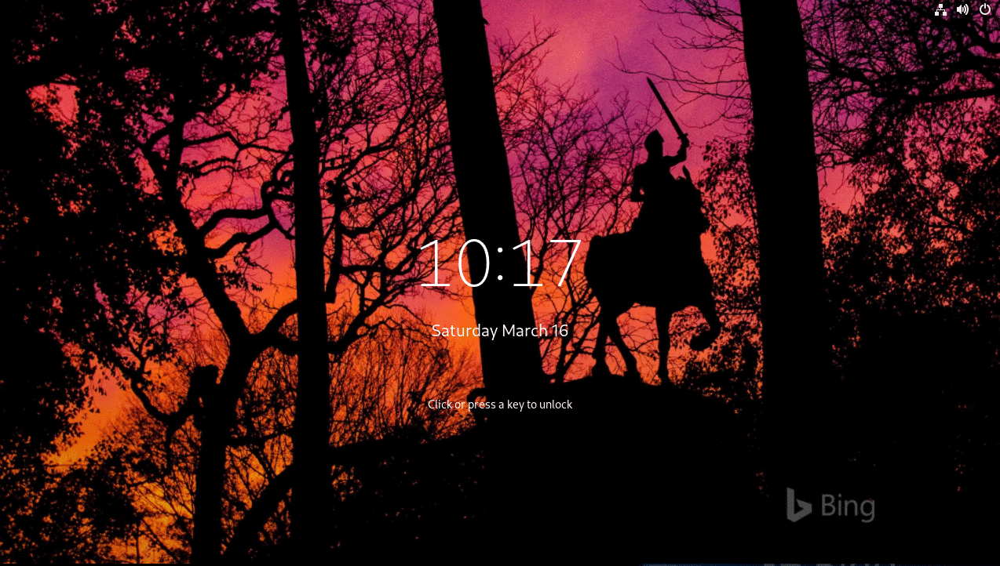

# gnome-shell-extension-unlockDialogBackground

Change unlock dialog background.

After you install extension, the extension will become enable. If you want to disable extension, you need to delete this extension or go to this extension settings to turn off switch.

## Install

```
make install
```

Then open **Lock screen background** preferences.

### GDM Login Screen (after reboot / logout)

The lock screen and the GDM login screen are different sessions. To use your image on the login screen too:

1. Open extension preferences
2. Scroll to **GDM Login Screen**
3. Click **Install Helper…** and enter your password in the system dialog  
   (or click **Copy Command** and paste into a terminal)
4. Click **Set Login Background** (password prompt again) to apply the picture above

- The helper is a small root script that copies your image to `/usr/local/share/backgrounds/` and updates Ubuntu’s GDM greeter settings.
- Click **Reset** to restore the default GDM background.
- If you change the lock-screen picture later, click **Set Login Background** again.

restart system

### From gnome extensions website

https://extensions.gnome.org/extension/1476/unlock-dialog-background/


